# MileStack

[简体中文](README.md) | [English](README.en.md)

**Keep developers and coding agents on the same page—without digging through stale TODO files or old chat history.**

MileStack is a local-first project progress and task-context database for agent-assisted development. It gives every new session a reliable answer to three questions: **Where is the project now? What is being worked on? What should happen next?**

> MileStack is an early V0 for local development workflows. Your project data stays on your machine.


## The problem it solves

Developers usually begin by working through requirements and a solution with a strong reasoning model, but the agreed result often remains trapped in that conversation. As the project moves between sessions, models, and developers, its real state gets scattered further across TODO files, plans, and handoff notes. Those sources quickly drift apart. The next agent has to reconstruct the project before it can make progress, while the developer has to remember which plan is still current.

MileStack replaces those temporary progress documents with one shared, structured source of truth:

- developers see current work, the ordered queue, blockers, review items, and recent completions in one dashboard;
- with a task ID, a coding agent loads the assigned task directly; without one, it queries project status and selects the first runnable task in the queue, then establishes execution ownership, records progress, and leaves a usable handoff;
- task dependencies and execution credentials make it clear what can start and prevent two sessions from executing the same task;
- review rounds stay tied to exact Git commits, with developer approval boundaries for higher-risk work;
- everything lives in a project-local SQLite database—no account, cloud service, or remote database required.

## How it fits into your workflow

```mermaid
flowchart LR
    D[Developer and reasoning model agree on requirements] --> T[AI turns the agreement into MileStack tasks]
    T --> C[Developer confirms risk and order]
    C --> I[Developer provides a task ID, or agent reads the next runnable task]
    I --> W[Implementation agent establishes ownership, executes, and submits]
    W --> Q[Developer sends the task ID to a review agent]
    Q --> R[Review and handoff stay in MileStack]
    R --> N[The next session continues from current state]
```



A typical project moves through a simple loop:

1. The developer and a strong reasoning model discuss the requirements and solution until the objective and boundaries are agreed.
2. The AI calls MileStack to turn that agreement into structured tasks instead of asking the developer to enter each task manually.
3. The developer reviews the AI-created inbox tasks and confirms their risk, dependencies, and order.
4. With a task ID, the implementation agent loads that task directly. Without one, it queries project status, selects the first task in `next` with `runnable = true`, and calls `start_task` to establish execution ownership.
5. The implementation agent records milestones, blockers, and handoff context, then submits a fixed Git commit.
6. The developer sends the task ID to an independent review agent, which calls `start_review` to establish review ownership and inspect the artifact.
7. The review result is stored in MileStack, and the dashboard and the next assigned agent session immediately see the updated state.

## Quick start

MileStack requires Node.js 22 or newer, and your project must be initialized as a Git repository.

```bash
npm install -g milestack

cd /absolute/path/to/your-project
milestack init --client codex
milestack serve
```

Then open [http://127.0.0.1:7331](http://127.0.0.1:7331).

Replace `codex` with `claude`, `cursor`, `grok`, or `opencode` to configure another supported project-level MCP client. You can repeat `--client` to configure several clients at once. AGY (Gemini CLI) uses dynamic project discovery and needs a one-time manual registration; see the [user guide](docs/user-guide.md#connect-a-coding-client).

Finally, add this line to the root `AGENTS.md` in your project so coding agents load the generated MileStack workflow rules:

```md
Before working on tasks, read and follow `.milestack/agent-instructions.md`.
```

Restart the coding client after initialization, then ask it to inspect the MileStack project status before starting work.

## What you get

| Capability | What it changes |
| --- | --- |
| One project view | Current work, next tasks, blockers, inbox items, reviews, and completed work no longer live in separate documents. |
| Session-to-session continuity | A new agent session can continue from structured task context and semantic history instead of replaying old chats. |
| Dependency-aware queue | Developers control task order while MileStack shows which tasks are actually runnable. |
| Explicit selection and ownership | The agent prioritizes a developer-provided task; otherwise it selects the next runnable queue item and atomically establishes execution ownership. |
| Reviewable delivery | Each review round points to an exact Git commit and keeps execution separate from review. |
| A steady Vibe Coding flow | New requests land in the inbox instead of interrupting the current task; progress and next steps stay recorded so work can resume without losing the thread. |
| Clear multi-project switching | Each project has its own visual progress view, making it easy to switch context, understand the current state, and dispatch work without keeping everything in your head. |
| Less implementation drift | The AI turns the agreed discussion into a structured task with objectives, constraints, and acceptance criteria—effectively giving the implementation agent a fuller prompt than an ad hoc chat message. |

## Supported interfaces

- **Web UI** for managing the queue, inbox, blockers, reviews, and completed work.
- **MCP** for coding agents to load an assigned task or query the next runnable task, establish execution or review ownership, update progress, and submit review results.
- **CLI** for project initialization, status checks, MCP startup, and the local web server.
- **HTTP API** shared by the Web UI and backed by the same task behavior as the CLI and MCP adapters.

MileStack's initialization flow currently supports Claude Code, Cursor, Grok, Codex, OpenCode, and AGY. For other MCP-compatible clients, follow the corresponding client documentation to add MileStack as an MCP server manually.

## Learn more

- [User guide](docs/user-guide.md) — installation choices, client setup, daily use, data location, and troubleshooting
- [Development guide](docs/development.md) — source builds, Web UI development, package testing, architecture, and verification
- [Product requirements](docs/requirements.md)
- [Technical design](docs/technical-design.md)
- [Bootstrap implementation history](docs/bootstrap-tasks.md)

## License

MileStack source code is licensed under the [Apache License 2.0](LICENSE).
