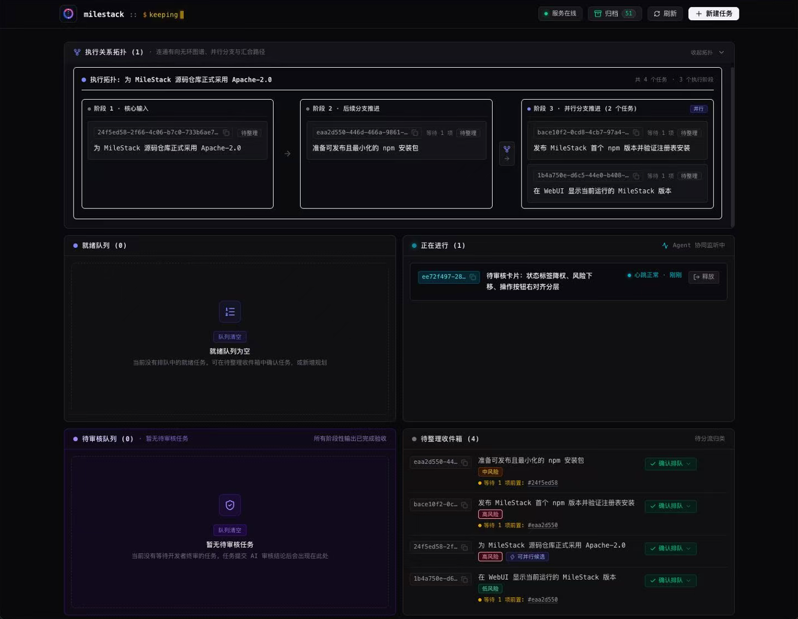
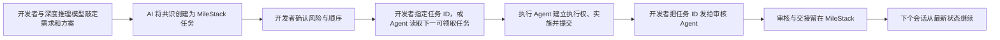

# MileStack

[简体中文](README.md) | [English](README.en.md)

**不用翻找过期的 TODO 和历史对话，也能让开发者与编程 Agent 始终知道项目做到哪了、接下来该做什么。**

MileStack 把项目进度和任务上下文统一保存在本地，让开发者与编程 Agent 始终基于同一份项目状态协作。它让每个新会话都能可靠回答三个问题：**项目目前进展如何？现在正在做什么？下一步该做什么？**

> MileStack 目前处于早期 V0 阶段，面向本地开发工作流。项目数据始终保存在你自己的机器上。



## MileStack 解决什么问题

开发者通常会先与擅长深度推理的模型讨论需求和方案，但讨论结论很容易停留在对话里。随着项目在不同会话、模型和开发者之间切换，真实进度又会继续散落到 TODO、计划文档和交接记录中。这些信息很快就会互相矛盾，新的 Agent 必须先重新拼凑项目上下文，开发者也得反复确认哪份计划才是最新的。

MileStack 用一个共享、结构化的事实源代替这些临时进度文档：

- 开发者可以在一个页面看到当前工作、待办顺序、阻塞、审核项和最近完成的任务；
- 编程 Agent 有任务 ID 时直接读取指定任务；没有任务 ID 时通过 MCP 查询项目状态并选择队列中第一个可领取任务，然后建立本轮执行权、记录进展并留下交接信息；
- 任务依赖和执行凭证明确展示哪些工作可以开始，并避免两个会话同时执行同一任务；
- 每轮审核都绑定到确切的 Git commit，高风险工作仍由开发者把关；
- 所有数据都保存在项目本地的 SQLite 数据库中，不需要账号、云服务或远程数据库。

## 它如何融入开发流程



一个项目通常按下面的闭环推进：

1. 开发者与擅长深度推理的模型讨论需求和方案，直到双方确认目标与边界。
2. AI 调用 MileStack，将已经确认的结论整理成结构化任务，而不是让开发者逐条手工录入。
3. 开发者检查 AI 创建的草稿任务，确认风险、依赖和执行顺序。
4. 有任务 ID 时，实施 Agent 直接读取指定任务；没有任务 ID 时，它先查询项目状态，选择 `next` 中第一个 `runnable = true` 的任务，再通过 `start_task` 建立本轮执行权。
5. 实施 Agent 记录阶段成果、阻塞和交接上下文，并以固定 Git commit 提交。
6. 开发者将任务 ID 发送给独立审核 Agent；审核 Agent 通过 `start_review` 建立审核权并检查制品。
7. 审核结果进入 MileStack，页面和下一个被分派的 Agent 会话随即看到最新状态。

## 三分钟开始使用

MileStack 需要 Node.js 22 或更高版本，以及请确保项目已初始化为 Git 仓库。

```bash
npm install -g milestack

cd /你的项目绝对路径
milestack init --client codex
milestack serve
```

然后打开 [http://127.0.0.1:7331](http://127.0.0.1:7331)。

如需配置其他支持项目级 MCP 的客户端，可以把 `codex` 替换为 `claude`、`cursor`、`grok` 或 `opencode`；也可以重复传入 `--client`，一次配置多个客户端。AGY（Gemini CLI）使用动态项目发现，需要进行一次手动全局注册，详见[用户指南](docs/user-guide.zh-CN.md#连接编程客户端)。

最后，在项目根目录的 `AGENTS.md` 中加入下面这行，让编程 Agent 读取 MileStack 生成的工作流规则：

```md
Before working on tasks, read and follow `.milestack/agent-instructions.md`.
```

初始化完成后重启编程客户端，并让它在开始工作前先查看 MileStack 项目状态。

## 你会得到什么

| 能力 | 带来的变化 |
| --- | --- |
| 统一的项目视图 | 当前任务、下一步、阻塞、草稿箱、待审核和已完成工作不再分散在多份文档里。 |
| 跨会话接续 | 新 Agent 会话直接读取结构化任务上下文和语义历史，不必重放旧对话。 |
| 感知依赖的队列 | 开发者决定执行顺序，MileStack 明确显示哪些任务现在真正可以开始。 |
| 明确的选择与执行权 | Agent 优先处理开发者指定的任务；未指定时按队列选择下一可领取任务，并原子建立执行权。 |
| 可审核的交付 | 每轮审核对应一个确切的 Git commit，执行权与审核权彼此分离。 |
| 稳定的 Vibe Coding 心流 | 新需求先进入草稿箱，不会突然打断当前任务，当前进度和下一步都被保留下来，可以接着推进。 |
| 清楚的多项目切换 | 每个项目都有独立的可视化进度页面，切换项目后也能迅速看清现状并下发任务，不必全靠大脑记忆。 |
| 更小的 AI 实现偏差 | AI 将讨论结论整理成包含目标、约束和验收条件的结构化任务，相当于补全并增强了实施提示词，比临时在对话框中描述更完整。 |

## 支持的使用方式

- **Web UI**：管理待办队列、草稿箱、阻塞、审核和已完成任务。
- **MCP**：让编程 Agent 读取指定任务或查询下一可领取任务、建立执行或审核权、更新进度，并提交审核结果。
- **CLI**：初始化项目、查询状态、启动 MCP 和本地 Web 服务。
- **HTTP API**：供 Web UI 使用，并与 CLI、MCP 共享同一套任务行为。

目前，MileStack 的初始化流程已适配 Claude Code、Cursor、Grok、Codex、OpenCode 和 AGY；其他支持 MCP 的客户端可参考各自文档手动接入 MileStack。

## 进一步了解

- [用户指南](docs/user-guide.zh-CN.md)：安装方式、客户端接入、日常使用、数据位置和常见问题
- [开发指南](docs/development.zh-CN.md)：源码构建、Web UI 开发、安装包测试、架构和验证方式
- [产品需求](docs/requirements.md)
- [技术方案](docs/technical-design.md)
- [自举开发历史](docs/bootstrap-tasks.md)

## 许可证

MileStack 源码采用 [Apache License 2.0](LICENSE) 授权。
