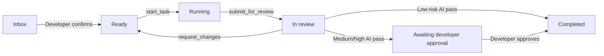

# MileStack

MileStack is a local-first project progress and task-context database for developers and coding agents. It keeps task state, dependencies, execution ownership, review artifacts, and semantic progress in one SQLite database instead of scattering them across temporary TODO files and chat handoffs.

MileStack is currently an early V0 intended for local development and agent-assisted workflows.

## Why MileStack

Coding agents often lose context when work moves between conversations, models, or developers. MileStack gives every participant the same durable project view:

- an ordered ready queue with dependency-aware `runnable` state;
- atomic task claiming through short-lived `runId` credentials;
- append-only semantic progress and handoff history;
- review rounds pinned to exact 40-character Git commit SHAs;
- independent review ownership through `reviewRunId` credentials;
- low, medium, and high risk policies with developer approval boundaries;
- CLI, MCP, HTTP, and web UI adapters backed by the same domain service;
- local SQLite storage with forward migrations and automatic pre-migration backups.

MileStack tracks meaningful project outcomes. It is not an agent identity system, command log, cloud service, or Git activity tracker.

## Workflow



Task execution and review use separate credentials. Submitting a task invalidates its `runId`; returning work for changes invalidates both old execution and review credentials. Rework must be claimed again and submitted as a new review round.

For concurrent implementation, give every writing agent its own branch and worktree. A task being `runnable` means it is claimable—it does not make a shared checkout safe for parallel edits.

## Architecture

All adapters delegate business behavior to one service:

```text
CLI --------\
MCP ---------> TaskService -> repository interface -> SQLite implementation
HTTP -------/                                      \
                                                     -> React UI via HTTP only
```

- `src/core` owns schemas, domain errors, repository interfaces, and state transitions.
- `src/db` owns Drizzle schema, migrations, SQLite configuration, and repositories.
- `src/cli`, `src/mcp`, and `src/server` are transport adapters.
- `ui` communicates only with the HTTP API.
- `tests` contains core, database, adapter, and real-process integration coverage.

Task snapshot updates and `TaskEvent` appends happen in the same database transaction.

## Requirements

- Node.js 22 or newer
- pnpm 10
- Git, when submitting fixed review artifacts

## Build from source

```bash
git clone git@github.com:SuperYang006/MileStack.git
cd MileStack
pnpm install
pnpm build
```

You can run the CLI directly from the checkout:

```bash
node dist/index.js --help
```

To make `milestack` available globally during development:

```bash
pnpm setup        # Run once if pnpm has no global bin directory
# Open a new shell after setup
pnpm link --global
milestack --help
```

## Initialize a project

With the global development link:

```bash
milestack init --project /absolute/path/to/project
```

Or run directly from this repository:

```bash
node /absolute/path/to/MileStack/dist/index.js init \
  --project /absolute/path/to/project
```

Initialization is idempotent. It:

- creates or migrates `.milestack/milestack.db`;
- adds `.milestack/` to `.gitignore` without replacing existing content;
- generates `.milestack/agent-instructions.md`;
- prints MCP client configuration and the root Agent-instruction entry point;
- never creates, overwrites, or appends to the project's root `AGENTS.md`.

Add this line manually to the project's version-controlled root `AGENTS.md`:

```md
Before working on tasks, read and follow .milestack/agent-instructions.md
```

Every developer should run `milestack init` in their own checkout because `.milestack/` is intentionally local and ignored.

## Connect Codex through MCP

When `milestack` is globally available:

```bash
codex mcp add milestack -- \
  milestack mcp --project /absolute/path/to/project
```

Without a global link, use the built CLI directly:

```bash
codex mcp add milestack -- \
  node /absolute/path/to/MileStack/dist/index.js \
  mcp --project /absolute/path/to/project
```

Verify the registration:

```bash
codex mcp list
codex mcp get milestack
```

Start a new Codex session after adding or changing MCP configuration so the updated tool list and server instructions are loaded.

## MCP tools

The current MCP server exposes:

| Area | Tools |
| --- | --- |
| Query | `get_project_status`, `list_tasks`, `get_task` |
| Task creation | `create_task`, `create_tasks` |
| Execution | `start_task`, `update_task`, `submit_for_review` |
| Review | `start_review`, `approve_review`, `request_changes`, `complete_review` |

Agent-created tasks enter `inbox`. A developer must confirm their risk and queue position before they can be claimed.

## CLI

```text
milestack init [--project <path>]
milestack status [--project <path>] [--json]
milestack mcp [--project <path>]
milestack serve [--project <path>] [--port <port>]
```

Examples:

```bash
milestack status --project /absolute/path/to/project
milestack status --project /absolute/path/to/project --json
milestack serve --project /absolute/path/to/project --port 7331
```

The web UI and HTTP API are served at `http://127.0.0.1:7331` by default.

## Risk and review policy

| Risk | After an independent AI pass |
| --- | --- |
| `low` | Completes automatically only when risk was developer-confirmed and verification evidence is present |
| `medium` | Remains `in_review` until a developer approves the latest passed review round |
| `high` | Remains `in_review` until a developer approves the latest passed review round |

Reviewers inspect the exact submitted commit, record the commands they actually ran, and return structured findings with a concrete issue, actionable suggestion, and severity when requesting changes.

## Local data and migrations

Project data is stored under `.milestack/` and must not be committed. SQLite connections enable WAL mode, foreign keys, and a busy timeout for safe access from the web server and multiple MCP processes.

Before applying a pending migration to an existing non-empty database, MileStack creates a backup under `.milestack/backups/`. Existing databases should never need to be deleted to upgrade.

## Development

```bash
pnpm typecheck
pnpm typecheck:ui
pnpm test
pnpm build
```

Tests use temporary projects and real SQLite databases where persistence or transaction behavior matters. The integration suite also exercises a real stdio MCP process and shared MCP/HTTP review workflows.

## Documentation

- [Product requirements](docs/requirements.md)
- [Technical design](docs/technical-design.md)
- [Bootstrap implementation history](docs/bootstrap-tasks.md)
