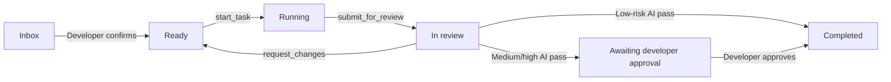

# MileStack

[English](README.md) | [简体中文](README.zh-CN.md)

MileStack is a local-first project progress and task-context database for developers and coding agents. It keeps task state, dependencies, execution ownership, review artifacts, and semantic progress in one SQLite database instead of scattering them across temporary TODO files and chat handoffs.

MileStack is currently an early V0 intended for local development and agent-assisted workflows.

## Why MileStack

Coding agents often lose context when work moves between conversations, models, or developers. MileStack gives every participant the same durable project view:

- an ordered ready queue with dependency-aware `runnable` state;
- atomic task claiming through short-lived `runId` credentials;
- append-only semantic progress and handoff history;
- review rounds pinned to exact 40-character Git commit SHAs;
- independent review ownership through `reviewRunId` credentials;
- low, medium, and high risk policies with developer approval boundaries;
- CLI, MCP, HTTP, and web UI adapters backed by the same domain service;
- local SQLite storage with forward migrations and automatic pre-migration backups.

MileStack tracks meaningful project outcomes. It is not an agent identity system, command log, cloud service, or Git activity tracker.

## Workflow



Task execution and review use separate credentials. Submitting a task invalidates its `runId`; returning work for changes invalidates both old execution and review credentials. Rework must be claimed again and submitted as a new review round.

For concurrent implementation, give every writing agent its own branch and worktree. A task being `runnable` means it is claimable—it does not make a shared checkout safe for parallel edits.

## Architecture

All adapters delegate business behavior to one service:

```text
CLI --------\
MCP ---------> TaskService -> repository interface -> SQLite implementation
HTTP -------/                                      \
                                                     -> React UI via HTTP only
```

- `src/core` owns schemas, domain errors, repository interfaces, and state transitions.
- `src/db` owns Drizzle schema, migrations, SQLite configuration, and repositories.
- `src/cli`, `src/mcp`, and `src/server` are transport adapters.
- `ui` communicates only with the HTTP API.
- `tests` contains core, database, adapter, and real-process integration coverage.

Task snapshot updates and `TaskEvent` appends happen in the same database transaction.

## Requirements

- Node.js 22 or newer
- pnpm 10
- Git, when submitting fixed review artifacts

## Build from source

```bash
git clone git@github.com:SuperYang006/MileStack.git
cd MileStack
pnpm install
pnpm build
```

You can run the CLI directly from the checkout:

```bash
node dist/index.js --help
```

To make `milestack` available globally during development:

```bash
pnpm setup        # Run once if pnpm has no global bin directory
# Open a new shell after setup
pnpm link --global
milestack --help
```

## Initialize a project

With the global development link:

```bash
milestack init --project /absolute/path/to/project
```

Or run directly from this repository:

```bash
node /absolute/path/to/MileStack/dist/index.js init \
  --project /absolute/path/to/project
```

Initialization is idempotent. Without `--client`, it:

- creates or migrates `.milestack/milestack.db`;
- adds `.milestack/` to `.gitignore` without replacing existing content;
- generates `.milestack/agent-instructions.md`;
- prints the generic MCP JSON and manual Codex registration instructions;
- does not create `.mcp.json`, `.cursor/mcp.json`, `.grok/config.toml`, or `.codex/config.toml`;
- never creates, overwrites, or appends to the project's root `AGENTS.md`.

To configure client MCP integration, explicitly select the clients for the current
checkout. `--client` may be repeated or given as a comma-separated list (supports `claude`, `cursor`, `grok`, `codex`, `agy`):

```bash
milestack init --client claude --client cursor --client grok --client codex --client agy \
  --project /absolute/path/to/current/checkout
```

Client support matrix:

| Client | Scope | Configuration file / mechanism | Behavior and notes |
| --- | --- | --- | --- |
| `claude` | Project-level | `.mcp.json` | Writes to current project directory, bound to checkout absolute path |
| `cursor` | Project-level | `.cursor/mcp.json` | Writes to current project directory, bound to checkout absolute path |
| `grok` | Project-level | `.grok/config.toml` | Writes to current project directory, bound to checkout absolute path |
| `codex` | Project-level | `.codex/config.toml` | Writes to current project directory, bound to checkout absolute path |
| `agy` | User-level | `~/.gemini/config/mcp_config.json` | Skips writing user-global files; outputs recommended `agy mcp` dynamic discovery command guidance |

Before running or submitting the command, verify that `--project` is the absolute
path of the current checkout. MileStack strictly enforces safety boundaries and **never modifies**
global client configuration such as `~/.claude.json`, `~/.cursor`, `~/.grok`, `~/.codex`, or `~/.gemini`.
An existing different `milestack` entry is preserved and not replaced. After writing a project file,
reopen the corresponding client session. Codex project configuration takes effect
only in trusted repositories, and Claude still requires user approval for the
project `.mcp.json` configuration. See below for detailed AGY (Gemini CLI) connection, dynamic root discovery, and migration instructions.

Add this line manually to the project's version-controlled root `AGENTS.md`:

```md
Before working on tasks, read and follow .milestack/agent-instructions.md
```

Every developer should run `milestack init` in their own checkout because `.milestack/` is intentionally local and ignored.

## Connect Codex through MCP

The commands below are an optional manual global registration path; `milestack init`
does not run them. To keep the configuration project-local, use
`milestack init --client codex --project /absolute/path/to/current/checkout` instead.

When `milestack` is globally available:

```bash
codex mcp add milestack -- \
  milestack mcp --project /absolute/path/to/project
```

Without a global link, use the built CLI directly:

```bash
codex mcp add milestack -- \
  node /absolute/path/to/MileStack/dist/index.js \
  mcp --project /absolute/path/to/project
```

Verify the registration:

```bash
codex mcp list
codex mcp get milestack
```

Start a new Codex session after adding or changing MCP configuration so the updated tool list and server instructions are loaded.

## Connect AGY (Gemini CLI) through MCP

Gemini Antigravity CLI (`agy`) currently provides only user-level global MCP configuration (managing `~/.gemini/config/mcp_config.json`) and does not support project-level MCP files.

### Why AGY cannot use a fixed project path

If `--project /path/to/projectA` were recorded as a fixed path in global configuration, opening an AGY session in `projectB` or any other directory would still connect to `projectA`'s database, silently reading or modifying the wrong task database.

To prevent cross-project state corruption, MileStack provides the `--discover` dynamic root-discovery mode: configure it **once globally** in AGY, and the single registration works across all initialized MileStack projects without project-specific re-registration.

### Installation and registration

When `milestack` is globally available, run:

```bash
agy mcp add milestack -- milestack mcp --discover
```

Without a global link, use the built CLI directly:

```bash
agy mcp add milestack -- \
  node /absolute/path/to/MileStack/dist/index.js \
  mcp --discover
```

Or manually add or update `milestack` under `mcpServers` in `~/.gemini/config/mcp_config.json`:

```json
"milestack": {
  "command": "milestack",
  "args": ["mcp", "--discover"]
}
```

### How it works and safe startup

- **Upward traversal**: When a session starts, `milestack mcp --discover` walks upward from the current working directory (or subdirectory) to locate the nearest ancestor directory containing `.milestack/milestack.db`, resolving and normalizing the path safely.
- **Fail-close safety**: If no initialized MileStack project is found in the current directory or its ancestors, or if the path is unsafe (such as a non-regular file), the service exits immediately with a clear error. It never falls back to historical projects or arbitrary databases.
- **Multi-root workspace boundaries**: When an AGY session opens multiple workspace roots, MileStack dynamically queries and validates all workspace roots:
  - If all roots map to the exact same MileStack project (e.g. subdirectories within the same checkout), startup succeeds and binds to that project;
  - If workspace roots span multiple distinct MileStack projects, or include uninitialized directories, MileStack **explicitly rejects and exits**, preventing ambiguous cross-project contamination.

### Verification

1. **Verify CLI registration**:

   ```bash
   agy mcp list
   ```

   Verify that the `milestack` entry is present with the `--discover` argument.

2. **Verify project binding**:
   Start an AGY session in an initialized project directory, have the agent call `get_project_status`, or run directly in your terminal:

   ```bash
   milestack status --discover
   ```

   Confirm that `project.name` and the returned tasks match the current checkout.

### Migrate from legacy fixed-project configuration

If you previously registered a global `milestack` entry tied to a specific project (e.g. containing `--project /path/to/projectA`):

1. **Replace the registration** (`agy mcp add` automatically overwrites an existing entry with the same name):

   ```bash
   agy mcp add milestack -- milestack mcp --discover
   ```

   Or explicitly remove and re-add:

   ```bash
   agy mcp remove milestack
   agy mcp add milestack -- milestack mcp --discover
   ```

2. **Restart the AGY session**: Close and reopen any running AGY session to load the updated configuration.
3. **Verify the bound project**: Start AGY in different project directories and call `get_project_status` to verify that each session independently inspects its own project rather than legacy project A.

### Removal

To remove the global MileStack MCP registration from AGY:

```bash
agy mcp remove milestack
```

## MCP tools

The current MCP server exposes:

| Area | Tools |
| --- | --- |
| Query | `get_project_status`, `list_tasks`, `get_task` |
| Task creation | `create_task`, `create_tasks` |
| Execution | `start_task`, `update_task`, `submit_for_review` |
| Review | `start_review`, `approve_review`, `request_changes`, `complete_review` |

Agent-created tasks enter `inbox`. A developer must confirm their risk and queue position before they can be claimed.

## CLI

```text
milestack init [--project <path>] [--client <name>]...
milestack status [--project <path>] [--discover] [--json]
milestack mcp [--project <path>] [--discover]
milestack serve [--project <path>] [--port <port>]
```

Examples:

```bash
milestack status --discover
milestack status --project /absolute/path/to/project
milestack status --project /absolute/path/to/project --json
milestack mcp --discover
milestack serve --project /absolute/path/to/project --port 7331
```

The web UI and HTTP API are served at `http://127.0.0.1:7331` by default.

## Risk and review policy

| Risk | After an independent AI pass |
| --- | --- |
| `low` | Completes automatically only when risk was developer-confirmed and verification evidence is present |
| `medium` | Remains `in_review` until a developer approves the latest passed review round |
| `high` | Remains `in_review` until a developer approves the latest passed review round |

Reviewers inspect the exact submitted commit, record the commands they actually ran, and return structured findings with a concrete issue, actionable suggestion, and severity when requesting changes.

## Local data and migrations

Project data is stored under `.milestack/` and must not be committed. SQLite connections enable WAL mode, foreign keys, and a busy timeout for safe access from the web server and multiple MCP processes.

Before applying a pending migration to an existing non-empty database, MileStack creates a backup under `.milestack/backups/`. Existing databases should never need to be deleted to upgrade.

## Development

```bash
pnpm typecheck
pnpm typecheck:ui
pnpm test
pnpm build
```

Tests use temporary projects and real SQLite databases where persistence or transaction behavior matters. The integration suite also exercises a real stdio MCP process and shared MCP/HTTP review workflows.

## Documentation

- [Product requirements](docs/requirements.md)
- [Technical design](docs/technical-design.md)
- [Bootstrap implementation history](docs/bootstrap-tasks.md)
