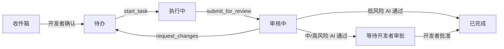

# MileStack

[English](README.md) | [简体中文](README.zh-CN.md)

MileStack 是一个面向开发者和编程 Agent 的本地优先项目进度与任务上下文数据库。它将任务状态、依赖关系、执行权、审核制品和语义进度统一保存在一个 SQLite 数据库中，避免这些信息分散在临时 TODO 文件和聊天交接记录里。

MileStack 目前处于早期 V0 阶段，面向本地开发和 Agent 辅助工作流。

## 为什么选择 MileStack

当工作在不同对话、模型或开发者之间切换时，编程 Agent 经常会丢失上下文。MileStack 为所有参与者提供同一份持久化项目视图：

- 按顺序排列、并根据依赖动态计算 `runnable` 状态的待办队列；
- 通过短生命周期 `runId` 凭证原子领取任务；
- 只追加的语义进度和交接历史；
- 绑定精确 40 位 Git commit SHA 的审核轮次；
- 通过 `reviewRunId` 凭证独立管理审核权；
- 具有开发者审批边界的低、中、高风险策略；
- 由同一个领域服务支持的 CLI、MCP、HTTP 和 Web UI 适配器；
- 支持前向迁移和迁移前自动备份的本地 SQLite 存储。

MileStack 记录有意义的项目成果。它不是 Agent 身份系统、命令日志、云服务或 Git 活动追踪器。

## 工作流



任务执行和审核使用不同的凭证。提交任务审核后，其 `runId` 会失效；退回返工会同时使旧的执行和审核凭证失效。返工任务必须重新领取，并作为新的审核轮次再次提交。

如果需要并行实现，请为每个会写入文件的 Agent 分配独立的分支和 worktree。任务的 `runnable` 只表示它可以被领取，并不意味着共享 checkout 可以安全地并行修改。

## 架构

所有适配器都将业务行为委托给同一个服务：

```text
CLI --------\
MCP ---------> TaskService -> repository interface -> SQLite implementation
HTTP -------/                                      \
                                                     -> React UI via HTTP only
```

- `src/core` 负责 Schema、领域错误、仓储接口和状态流转；
- `src/db` 负责 Drizzle Schema、迁移、SQLite 配置和仓储实现；
- `src/cli`、`src/mcp` 和 `src/server` 是传输适配器；
- `ui` 只通过 HTTP API 通信；
- `tests` 包含核心、数据库、适配器和真实进程集成测试。

任务快照更新和 `TaskEvent` 追加会在同一个数据库事务中完成。

## 环境要求

- Node.js 22 或更高版本
- pnpm 10
- Git（提交固定审核制品时需要）

## 通过 npm 安装

```bash
npm install -g milestack
milestack --help
```

全局安装是使用 MileStack 的首选方式。持久 MCP 配置指向 `milestack` 命令，
该命令需要在每个客户端会话中始终位于 `PATH` 上。

如果某个仓库希望锁定 CLI 版本，也可以把 MileStack 作为项目 devDependency 安装。
请安装到项目自身，再通过 `init` 写入客户端配置，这样每个客户端都会得到自己支持的格式：

```bash
npm install --save-dev milestack
./node_modules/.bin/milestack init --client claude --client cursor --client grok --client codex --client opencode \
  --project /absolute/path/to/project
```

当 `init` 从项目自身的 `node_modules` 运行时，即使 `PATH` 上还有另一个
`milestack`，条目也会固定到该项目内安装的这一份：

```json
"milestack": {
  "command": "<node 绝对路径>",
  "args": ["<项目>/node_modules/.bin/milestack", "mcp", "--project", "<项目绝对路径>"]
}
```

Codex 与 Grok 会在各自的 TOML 文件中得到同样的 command 与 args，OpenCode 则得到
它自己的 `mcp.milestack` 结构。当 `init` 从其他位置运行时：若 `PATH` 上存在
`milestack` 则记录该命令，否则记录正在执行 `init` 的 CLI 入口。
参见[初始化项目](#初始化项目)中的客户端支持矩阵。

请通过项目内的二进制运行 `init`，不要使用 `npx milestack` 或 `npm exec`：
这两者会把临时的 `milestack` 放到 `PATH` 上，`init` 就会记录裸的
`milestack` 命令，该缓存在被清理后配置随即失效。一次性运行 `npx milestack`
同样不能作为持久 MCP 配置。

## 从源码构建

```bash
git clone git@github.com:SuperYang006/MileStack.git
cd MileStack
pnpm install
pnpm build
```

可以直接从 checkout 运行 CLI：

```bash
node dist/index.js --help
```

开发时如需全局使用 `milestack`：

```bash
pnpm setup        # 如果 pnpm 没有全局 bin 目录，只需执行一次
# setup 完成后打开一个新的 shell
pnpm link --global
milestack --help
```

## 初始化项目

如果已经建立全局开发链接：

```bash
milestack init --project /absolute/path/to/project
```

也可以直接从本仓库运行：

```bash
node /absolute/path/to/MileStack/dist/index.js init \
  --project /absolute/path/to/project
```

初始化操作是幂等的。不传 `--client` 时会：

- 创建或迁移 `.milestack/milestack.db`；
- 在不替换现有内容的前提下，将 `.milestack/` 加入 `.gitignore`；
- 生成 `.milestack/agent-instructions.md`；
- 输出通用 MCP JSON 以及手动注册 Codex 与 AGY 的说明；
- 不创建 `.mcp.json`、`.cursor/mcp.json`、`.grok/config.toml`、`.codex/config.toml` 或 `opencode.json`；
- 不会创建、覆盖或追加项目根目录中的 `AGENTS.md`。

如需配置客户端 MCP 接入，必须为当前 checkout 显式选择客户端。`--client`
可以重复，也可以使用逗号分隔的列表（支持 `claude`、`cursor`、`grok`、`codex`、`opencode`、`agy`）：

```bash
milestack init --client claude --client cursor --client grok --client codex --client opencode --client agy \
  --project /absolute/path/to/current/checkout
```

客户端支持矩阵：

| 客户端 | 作用域 | 配置文件 / 方式 | 行为与说明 |
| --- | --- | --- | --- |
| `claude` | 项目级 | `.mcp.json` | 写入当前项目目录，绑定当前 checkout 绝对路径 |
| `cursor` | 项目级 | `.cursor/mcp.json` | 写入当前项目目录，绑定当前 checkout 绝对路径 |
| `grok` | 项目级 | `.grok/config.toml` | 写入当前项目目录，绑定当前 checkout 绝对路径 |
| `codex` | 项目级 | `.codex/config.toml` | 写入当前项目目录，绑定当前 checkout 绝对路径 |
| `opencode` | 项目级 | `opencode.json` | 写入顶层 `mcp.milestack`：`type` 为 `local`，`command` 为 `milestack mcp --project <当前 checkout 绝对路径>`，`enabled` 为 true，不使用 `--discover`；`PATH` 中没有 `milestack` 时改用当前 CLI 入口文件 |
| `agy` | 用户级 | `~/.gemini/config/mcp_config.json` | 不修改用户全局文件；输出推荐的 `agy mcp` 动态发现命令指引 |

新建的 `opencode.json` 会带上 `$schema` `https://opencode.ai/config.json`。若项目中只存在 `opencode.jsonc`，`init` 会打印需要手写的 `mcp.milestack` 条目，并不修改该文件。

`init` 通过 `PATH` 解析 `milestack` 命令。如果 `milestack` 没有全局安装，写入的条目会改用正在执行 `init` 的 CLI 本身，而不再使用裸命令，因此在没有全局安装时仍然可用。从目标项目自身 `node_modules` 启动的 CLI 优先于 `PATH`，因此项目 devDependency 始终被固定：

```json
"milestack": {
  "type": "local",
  "command": ["<node 绝对路径>", "<执行 init 的 CLI 入口文件绝对路径>", "mcp", "--project", "<当前 checkout 绝对路径>"],
  "enabled": true
}
```

JSON 与 TOML 客户端通过 `command` 加 `args` 使用同一回退方式，`init` 会在每个客户端的输出中说明这一选择。该回退条目本身可以继续使用。`init` 不会改写已有的不同 `milestack` 条目，因此若要把已有条目换成普通的 `milestack` 命令，需要手动删除或修改该客户端项目级配置中的 `milestack` 条目，再重新运行 `init`。

`opencode.json` 绑定生成它的那个 checkout 的绝对路径，属于每个 checkout 各自的本地配置，应加入忽略列表。`milestack init` 只自动维护 `.milestack/` 的忽略条目；本仓库在自身 `.gitignore` 中显式忽略 `opencode.json`。

执行或提交前请确认 `--project` 是当前 checkout 的绝对路径。MileStack 严格遵守安全边界，**绝不自动修改**
`~/.claude.json`、`~/.cursor`、`~/.grok`、`~/.codex`、`~/.config/opencode` 或 `~/.gemini` 等全局客户端配置，
也不会执行 `opencode mcp add`。OpenCode 会把项目级 `opencode.json` 与 `~/.config/opencode/opencode.json`
合并，同名 MCP 服务以项目条目为准，因此仅项目文件就足够。
已有不同的 `milestack` 条目会保持不变，不会被覆盖。写入项目文件后，请重新打开
对应的客户端会话。Codex 项目配置只会在已信任的仓库中生效；Claude 的项目
`.mcp.json` 配置仍需用户批准。关于 AGY（Gemini CLI）的详细连接、动态寻根与迁移方法，请参见下文专门章节。

请手动将下面这行加入项目版本控制中的根 `AGENTS.md`：

```md
Before working on tasks, read and follow `.milestack/agent-instructions.md`.
```

`milestack init` 只会读取根 `AGENTS.md`，不会创建、追加或覆盖该文件，因为已有项目指令不应在未经你确认的情况下被替换。每次 `init` 结束时会输出摘要，说明该引用是否已经存在；若尚未引用，摘要会给出可直接复制的原始指令，说明不添加可能导致 Coding Agent 无法读取 MileStack 工作流规则，并提示完成后重新打开本次通过 `--client` 配置的客户端会话，而不是固定某一个客户端。

每位开发者都应在自己的 checkout 中运行 `milestack init`，因为 `.milestack/` 是有意保持本地化并被忽略的目录。

## 通过 MCP 连接 Codex

下面的命令是可选的手动全局注册方式，`milestack init` 不会自动执行它们。
如需保持配置只属于当前项目，请改用
`milestack init --client codex --project /absolute/path/to/current/checkout`。

当 `milestack` 已经可以全局使用时：

```bash
codex mcp add milestack -- \
  milestack mcp --project /absolute/path/to/project
```

如果没有建立全局链接，可以使用构建后的 CLI：

```bash
codex mcp add milestack -- \
  node /absolute/path/to/MileStack/dist/index.js \
  mcp --project /absolute/path/to/project
```

验证注册结果：

```bash
codex mcp list
codex mcp get milestack
```

新增或修改 MCP 配置后，请重新启动 Codex 会话，使更新后的工具列表和服务端说明生效。

## 通过 MCP 连接 AGY（Gemini CLI）

Gemini Antigravity CLI（`agy`）目前仅提供用户级全局 MCP 配置（管理 `~/.gemini/config/mcp_config.json`），不支持项目级 MCP 配置文件。

### 为什么不能为 AGY 写入固定项目路径

如果将 `--project /path/to/projectA` 作为固定路径写入全局配置，当你在 `projectB` 或其他目录打开 AGY 会话时，它仍然会连接到 `projectA` 的数据库，导致跨项目静默读写错误的任务状态。

因此，MileStack 提供了 `--discover` 动态寻根模式：只需在 AGY 中**一次性全局注册**，即可在所有已执行 `milestack init` 的项目中通用，无需为每个项目重新配置。

### 安装与注册

当 `milestack` 已经全局可用时，直接运行：

```bash
agy mcp add milestack -- milestack mcp --discover
```

如果没有建立全局链接，可以使用构建后的 CLI：

```bash
agy mcp add milestack -- \
  node /absolute/path/to/MileStack/dist/index.js \
  mcp --discover
```

若需手动配置，请在 `~/.gemini/config/mcp_config.json` 的 `mcpServers` 中添加或更新：

```json
"milestack": {
  "command": "milestack",
  "args": ["mcp", "--discover"]
}
```

### 工作原理与安全启动

- **初始项目来源**：进程启动时，`milestack mcp --discover` 会先校验 `WORKSPACE_DIRS` 或 `ANTIGRAVITY_WORKSPACE_DIRS` 提供的非空工作区根。如果两个变量都没有提供工作区根，才会从当前工作目录（或所在子目录）自动向上查找最近包含 `.milestack/milestack.db` 的项目根目录，并进行绝对路径规范化与常规文件安全性校验。
- **失败关闭（Fail-Close）**：如果环境变量提供的工作区根无法唯一映射到一个已初始化的 MileStack 项目，或从环境变量及当前目录祖先中都未找到项目，或数据库路径不安全（如非正常文件），服务会立即输出清晰错误并退出，绝不回退到历史项目或任意无关数据库。
- **多根工作区边界**：MileStack 会在启动时校验环境工作区根；客户端声明 MCP `roots` capability 后，还会在握手完成时校验客户端提供的工作区根：
  - 若客户端声明了 `roots` capability，MileStack 会在握手完成后通过 `roots/list` 获取并校验返回的非空工作区根（并在多根项目身份比较时尝试 realpath 规范化）。若所有工作区根均映射到同一个 MileStack 项目（例如属于同一项目的不同子目录），绑定该项目；若工作区根跨越不同的 MileStack 项目或包含未初始化的目录，MileStack 会**明确拒绝启动并失败关闭**，防止跨项目静默混淆；
  - 若客户端未声明 `roots` capability，服务端无法感知或验证客户端附加的工作区根。如果同时没有环境变量提供工作区根，cwd 就是唯一项目来源；此时必须作为单根工作区使用，并确保直接从目标项目目录启动会话。

### 验证

1. **验证 CLI 注册**：

   ```bash
   agy mcp list
   ```

   应看到 `milestack` 条目且参数包含 `--discover`。

2. **验证项目绑定**：
   在已初始化的项目目录中启动 AGY 会话，AI 调用 `get_project_status` 工具，或直接在终端运行：

   ```bash
   milestack status --discover
   ```

   确认终端输出中显示的项目名称与任务列表与当前项目完全一致（若使用 `--json`，可核对 `project.name` 字段）。

### 从旧的固定项目配置迁移

如果你之前曾为 AGY 全局注册过绑定到某单项目固定路径的 `milestack` 条目（例如包含 `--project /path/to/projectA`）：

1. **替换注册**（`agy mcp add` 会自动替换同名条目）：

   ```bash
   agy mcp add milestack -- milestack mcp --discover
   ```

   也可以显式先移除再添加：

   ```bash
   agy mcp remove milestack
   agy mcp add milestack -- milestack mcp --discover
   ```

2. **重启 AGY 会话**：关闭并重新打开当前会话使新配置生效。
3. **确认绑定**：在不同项目的目录中启动 AGY 会话，分别通过 `get_project_status` 工具或 `milestack status --discover` 确认各自独立读取当前项目的状态与任务，不再固定到旧项目 A。

### 移除

如需移除 AGY 的全局 MileStack MCP 注册：

```bash
agy mcp remove milestack
```

## MCP 工具

当前 MCP 服务提供以下工具：

| 类别 | 工具 |
| --- | --- |
| 查询 | `get_project_status`、`list_tasks`、`get_task` |
| 创建任务 | `create_task`、`create_tasks` |
| 执行 | `start_task`、`update_task`、`submit_for_review` |
| 审核 | `start_review`、`approve_review`、`request_changes`、`complete_review` |

Agent 创建的任务会进入 `inbox`。开发者必须先确认其风险和队列位置，任务才能被领取。

## CLI

```text
milestack init [--project <path>] [--client <name>]...
milestack status [--project <path>] [--discover] [--json]
milestack mcp [--project <path>] [--discover]
milestack serve [--project <path>] [--port <port>]
```

示例：

```bash
milestack status --discover
milestack status --project /absolute/path/to/project
milestack status --project /absolute/path/to/project --json
milestack mcp --discover
milestack serve --project /absolute/path/to/project --port 7331
```

Web UI 和 HTTP API 默认通过 `http://127.0.0.1:7331` 提供服务。

## 风险与审核策略

| 风险等级 | 独立 AI 审核通过后 |
| --- | --- |
| `low` | 仅在风险已由开发者确认且存在验证证据时自动完成 |
| `medium` | 保持 `in_review`，直到开发者批准最新一轮已通过的审核 |
| `high` | 保持 `in_review`，直到开发者批准最新一轮已通过的审核 |

审核者会检查提交的确切制品，记录实际运行的命令，并在退回修改时提供包含具体问题、可执行建议和严重度的结构化反馈。

## 本地数据与迁移

项目数据保存在 `.milestack/` 下，不应提交到 Git。SQLite 连接启用 WAL 模式、外键约束和 busy timeout，以支持 Web 服务和多个 MCP 进程安全访问。

对已有非空数据库应用待执行迁移前，MileStack 会在 `.milestack/backups/` 下创建备份。升级时不应删除现有数据库。

## 开发

```bash
pnpm typecheck
pnpm typecheck:ui
pnpm test
pnpm build
```

测试使用临时项目和真实 SQLite 数据库来验证持久化或事务行为。集成测试还会运行真实的 stdio MCP 进程，并覆盖共享的 MCP/HTTP 审核工作流。

## 文档

- [产品需求](docs/requirements.md)
- [技术方案](docs/technical-design.md)
- [自举开发历史](docs/bootstrap-tasks.md)

## 许可证

MileStack 源码采用 [Apache License 2.0](LICENSE) 授权。
