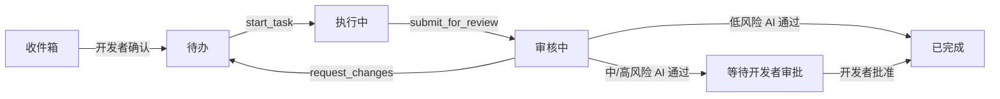

# MileStack

[English](README.md) | [简体中文](README.zh-CN.md)

MileStack 是一个面向开发者和编程 Agent 的本地优先项目进度与任务上下文数据库。它将任务状态、依赖关系、执行权、审核制品和语义进度统一保存在一个 SQLite 数据库中，避免这些信息分散在临时 TODO 文件和聊天交接记录里。

MileStack 目前处于早期 V0 阶段，面向本地开发和 Agent 辅助工作流。

## 为什么选择 MileStack

当工作在不同对话、模型或开发者之间切换时，编程 Agent 经常会丢失上下文。MileStack 为所有参与者提供同一份持久化项目视图：

- 按顺序排列、并根据依赖动态计算 `runnable` 状态的待办队列；
- 通过短生命周期 `runId` 凭证原子领取任务；
- 只追加的语义进度和交接历史；
- 绑定精确 40 位 Git commit SHA 的审核轮次；
- 通过 `reviewRunId` 凭证独立管理审核权；
- 具有开发者审批边界的低、中、高风险策略；
- 由同一个领域服务支持的 CLI、MCP、HTTP 和 Web UI 适配器；
- 支持前向迁移和迁移前自动备份的本地 SQLite 存储。

MileStack 记录有意义的项目成果。它不是 Agent 身份系统、命令日志、云服务或 Git 活动追踪器。

## 工作流



任务执行和审核使用不同的凭证。提交任务审核后，其 `runId` 会失效；退回返工会同时使旧的执行和审核凭证失效。返工任务必须重新领取，并作为新的审核轮次再次提交。

如果需要并行实现，请为每个会写入文件的 Agent 分配独立的分支和 worktree。任务的 `runnable` 只表示它可以被领取，并不意味着共享 checkout 可以安全地并行修改。

## 架构

所有适配器都将业务行为委托给同一个服务：

```text
CLI --------\
MCP ---------> TaskService -> repository interface -> SQLite implementation
HTTP -------/                                      \
                                                     -> React UI via HTTP only
```

- `src/core` 负责 Schema、领域错误、仓储接口和状态流转；
- `src/db` 负责 Drizzle Schema、迁移、SQLite 配置和仓储实现；
- `src/cli`、`src/mcp` 和 `src/server` 是传输适配器；
- `ui` 只通过 HTTP API 通信；
- `tests` 包含核心、数据库、适配器和真实进程集成测试。

任务快照更新和 `TaskEvent` 追加会在同一个数据库事务中完成。

## 环境要求

- Node.js 22 或更高版本
- pnpm 10
- Git（提交固定审核制品时需要）

## 从源码构建

```bash
git clone git@github.com:SuperYang006/MileStack.git
cd MileStack
pnpm install
pnpm build
```

可以直接从 checkout 运行 CLI：

```bash
node dist/index.js --help
```

开发时如需全局使用 `milestack`：

```bash
pnpm setup        # 如果 pnpm 没有全局 bin 目录，只需执行一次
# setup 完成后打开一个新的 shell
pnpm link --global
milestack --help
```

## 初始化项目

如果已经建立全局开发链接：

```bash
milestack init --project /absolute/path/to/project
```

也可以直接从本仓库运行：

```bash
node /absolute/path/to/MileStack/dist/index.js init \
  --project /absolute/path/to/project
```

初始化操作是幂等的，具体会：

- 创建或迁移 `.milestack/milestack.db`；
- 在不替换现有内容的前提下，将 `.milestack/` 加入 `.gitignore`；
- 生成 `.milestack/agent-instructions.md`；
- 输出 MCP 客户端配置和根 Agent 指令入口；
- 不会创建、覆盖或追加项目根目录中的 `AGENTS.md`。

请手动将下面这行加入项目版本控制中的根 `AGENTS.md`：

```md
Before working on tasks, read and follow .milestack/agent-instructions.md
```

每位开发者都应在自己的 checkout 中运行 `milestack init`，因为 `.milestack/` 是有意保持本地化并被忽略的目录。

## 通过 MCP 连接 Codex

当 `milestack` 已经可以全局使用时：

```bash
codex mcp add milestack -- \
  milestack mcp --project /absolute/path/to/project
```

如果没有建立全局链接，可以使用构建后的 CLI：

```bash
codex mcp add milestack -- \
  node /absolute/path/to/MileStack/dist/index.js \
  mcp --project /absolute/path/to/project
```

验证注册结果：

```bash
codex mcp list
codex mcp get milestack
```

新增或修改 MCP 配置后，请重新启动 Codex 会话，使更新后的工具列表和服务端说明生效。

## MCP 工具

当前 MCP 服务提供以下工具：

| 类别 | 工具 |
| --- | --- |
| 查询 | `get_project_status`、`list_tasks`、`get_task` |
| 创建任务 | `create_task`、`create_tasks` |
| 执行 | `start_task`、`update_task`、`submit_for_review` |
| 审核 | `start_review`、`approve_review`、`request_changes`、`complete_review` |

Agent 创建的任务会进入 `inbox`。开发者必须先确认其风险和队列位置，任务才能被领取。

## CLI

```text
milestack init [--project <path>]
milestack status [--project <path>] [--json]
milestack mcp [--project <path>]
milestack serve [--project <path>] [--port <port>]
```

示例：

```bash
milestack status --project /absolute/path/to/project
milestack status --project /absolute/path/to/project --json
milestack serve --project /absolute/path/to/project --port 7331
```

Web UI 和 HTTP API 默认通过 `http://127.0.0.1:7331` 提供服务。

## 风险与审核策略

| 风险等级 | 独立 AI 审核通过后 |
| --- | --- |
| `low` | 仅在风险已由开发者确认且存在验证证据时自动完成 |
| `medium` | 保持 `in_review`，直到开发者批准最新一轮已通过的审核 |
| `high` | 保持 `in_review`，直到开发者批准最新一轮已通过的审核 |

审核者会检查提交的确切制品，记录实际运行的命令，并在退回修改时提供包含具体问题、可执行建议和严重度的结构化反馈。

## 本地数据与迁移

项目数据保存在 `.milestack/` 下，不应提交到 Git。SQLite 连接启用 WAL 模式、外键约束和 busy timeout，以支持 Web 服务和多个 MCP 进程安全访问。

对已有非空数据库应用待执行迁移前，MileStack 会在 `.milestack/backups/` 下创建备份。升级时不应删除现有数据库。

## 开发

```bash
pnpm typecheck
pnpm typecheck:ui
pnpm test
pnpm build
```

测试使用临时项目和真实 SQLite 数据库来验证持久化或事务行为。集成测试还会运行真实的 stdio MCP 进程，并覆盖共享的 MCP/HTTP 审核工作流。

## 文档

- [产品需求](docs/requirements.md)
- [技术方案](docs/technical-design.md)
- [自举开发历史](docs/bootstrap-tasks.md)
