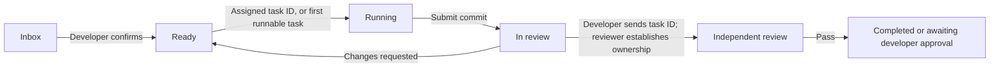

# MileStack user guide

[English](user-guide.md) | [简体中文](user-guide.zh-CN.md) | [Back to README](../README.en.md)

This guide covers installing MileStack, connecting it to a coding client, and using it in an existing project. For source builds and contribution workflows, see the [development guide](development.md).

## Requirements

- Node.js 22 or newer
- Git when an agent submits a fixed commit for review
- A supported MCP client if you want coding agents to read and update MileStack directly

## Install MileStack

### Global installation

This is the recommended option for most users:

```bash
npm install -g milestack
milestack --help
```

Persistent MCP configuration points to the `milestack` command, so the command must remain available on `PATH` whenever the coding client starts.

### Project-pinned installation

Use a development dependency when a repository needs to pin a specific MileStack version:

```bash
cd /absolute/path/to/project
npm install --save-dev milestack
./node_modules/.bin/milestack init --client codex --project "$PWD"
```

Run `init` through the project binary. Do not use `npx milestack` or `npm exec milestack` for persistent setup: those runners may expose a temporary command that stops working after their cache is cleared.

## Initialize a project

```bash
cd /absolute/path/to/project
milestack init --project "$PWD"
```

Initialization is safe to repeat. It:

- creates or migrates `.milestack/milestack.db`;
- adds `.milestack/` to `.gitignore` without replacing existing content;
- generates `.milestack/agent-instructions.md`;
- prints generic MCP configuration guidance;
- leaves the root `AGENTS.md` and global client configuration untouched.

Add the following line to the project's version-controlled root `AGENTS.md`:

```md
Before working on tasks, read and follow `.milestack/agent-instructions.md`.
```

MileStack deliberately does not create or edit the root `AGENTS.md`: project-level agent instructions require developer review.

Every developer should run `milestack init` in each checkout. The `.milestack/` directory is local and intentionally ignored by Git.

## Connect a coding client

For clients that support project-level MCP configuration, pass one or more explicit `--client` values:

```bash
milestack init \
  --client claude \
  --client cursor \
  --client grok \
  --client codex \
  --client opencode \
  --project "$PWD"
```

| Client | Project configuration | Notes |
| --- | --- | --- |
| Claude | `.mcp.json` | Claude asks for approval before using project MCP configuration. |
| Cursor | `.cursor/mcp.json` | Bound to the absolute path of the current checkout. |
| Grok | `.grok/config.toml` | Bound to the absolute path of the current checkout. |
| Codex | `.codex/config.toml` | The repository must be trusted before project configuration takes effect. |
| OpenCode | `opencode.json` | Uses the official top-level `mcp.milestack` shape. |
| AGY | Manual user-level registration | Uses dynamic project discovery instead of a fixed project path. |

`init` only adds a missing MileStack entry. It preserves unrelated settings and an existing different `milestack` entry. It never changes global configuration under `~/.claude.json`, `~/.cursor`, `~/.grok`, `~/.codex`, `~/.config/opencode`, or `~/.gemini`.

After creating or changing client configuration, restart that coding client.

### AGY (Gemini CLI)

AGY currently uses user-level MCP configuration. A fixed `--project` path would make every AGY workspace point to the same project, so MileStack uses fail-closed dynamic discovery instead:

```bash
agy mcp add milestack -- milestack mcp --discover
agy mcp list
```

Start AGY from an initialized project, then verify the binding:

```bash
milestack status --discover
```

Discovery accepts only workspace roots that resolve to one initialized MileStack project. It exits with an error rather than selecting an arbitrary project when roots are missing, unsafe, or ambiguous.

To replace a legacy fixed-project registration:

```bash
agy mcp remove milestack
agy mcp add milestack -- milestack mcp --discover
```

## Open the project dashboard

```bash
milestack serve --project "$PWD"
```

Open [http://127.0.0.1:7331](http://127.0.0.1:7331). The dashboard shows:

- work currently being executed;
- the ordered ready queue and unfinished dependencies;
- blocked tasks and the action needed to unblock them;
- implementations waiting for review;
- inbox work that still needs developer triage;
- recently completed tasks.

The server listens on the local loopback interface by default. To use another port:

```bash
milestack serve --project "$PWD" --port 7332
```

## Day-to-day workflow

### Developer responsibilities

1. Work through the requirements and solution with a strong reasoning model, confirming the objective, boundaries, and important constraints.
2. Review the inbox tasks created by the AI from that discussion and check that nothing was omitted or expanded without agreement.
3. Choose task risk, verify dependencies, and order the ready queue.
4. Send a task ID or brief when you want a specific task implemented; otherwise the agent selects the first runnable task in queue order.
5. After submission, send the same task ID to an independent review agent; the reviewer does not select a review task itself.
6. Review blockers and actions that require human input; approve medium- and high-risk work after an independent review passes.
7. Edit, reopen, or return work when the task definition or submitted result needs correction.

### Coding-agent responsibilities

1. After the requirements and solution are agreed, turn the discussion into concrete, verifiable MileStack inbox tasks without inventing unconfirmed scope.
2. As an implementation agent, load a developer-provided task ID directly. If no task ID is provided, query project status, select the first task in `next` with `runnable = true`, then call `start_task` to establish execution ownership.
3. Record meaningful milestones, the current step, the next step, or a blocker—rather than every command and file edit.
4. Create another inbox task when independent follow-up work is discovered during implementation.
5. Submit a fixed 40-character Git commit and leave a clear completion summary.
6. As a review agent, first receive a task ID from the developer, then call `start_review` to establish review ownership; do not select a pending review yourself.

The ready queue expresses developer preference. Dependencies determine whether a ready task is runnable. If several tasks are runnable, they may be worked on in parallel only when each writing agent has an isolated branch and worktree.

## Task and review lifecycle



An implementation agent prioritizes a developer-provided task. If no task ID is provided, it selects the first runnable task in queue order. Review work is still assigned by sending the task ID to an independent review agent. `start_task` and `start_review` establish concurrency-safe, short-lived credentials. Submitting invalidates the execution credential. Returning work for changes invalidates the old execution and review credentials, so rework must establish new execution ownership before a new review round.

| Risk | After an independent AI review passes |
| --- | --- |
| Low | The review records automatic acceptance; completion follows only after the local integration requirement is satisfied. |
| Medium | Waits for developer approval, then for the local integration requirement if required. |
| High | Waits for developer approval, then for the local integration requirement if required. |

### Local integration and completion

Every new task defaults to requiring its fixed reviewed commit on the local `main` branch. Before work starts, a developer can choose another local target branch or record that Git integration is not required, with a reason. The review round freezes that choice. After the risk-specific review and approval requirements are met, MileStack checks whether the exact reviewed commit is reachable from the selected local branch. If Git cannot prove that, the approval remains recorded, the task stays visible, and dependents remain blocked. Use **Check and archive** to retry after an authorized local merge or a Git repair. The check is read-only; it does not merge, fetch, or push, and it does not mean the work was published or deployed. A squash or rebase that changes the reviewed commit SHA cannot be proven by this check.

## CLI reference

```text
milestack init [--project <path>] [--client <name>]...
milestack status [--project <path>] [--discover] [--json]
milestack mcp [--project <path>] [--discover]
milestack serve [--project <path>] [--port <port>]
milestack update [--project <path>] [--check]
milestack -v | --version
```

Examples:

```bash
milestack status --project "$PWD"
milestack status --project "$PWD" --json
milestack status --discover
milestack mcp --discover
```

## MCP capabilities

| Area | Tools |
| --- | --- |
| Query | `get_project_status`, `list_tasks`, `get_task` |
| Task creation | `create_task`, `create_tasks` |
| Execution | `start_task`, `update_task`, `submit_for_review` |
| Review | `start_review`, `approve_review`, `request_changes`, `complete_review`, `check_task_integration` |

Agent-created tasks enter the inbox. A developer must confirm their risk and queue position before they become claimable.

`get_task` defaults to the `working` view, which keeps the full task definition and current work context. Pass `view: "full"` to inspect every immutable task event and review record. The HTTP task-detail endpoint used by the Web UI always returns the full timeline.

## Local data and upgrades

Project data is stored in `.milestack/` and must not be committed. SQLite connections use WAL mode, foreign keys, and a busy timeout so the local web server and MCP processes can share the database safely.

Before applying a pending migration to a non-empty database, MileStack creates a backup in `.milestack/backups/`. Do not delete an existing database to upgrade.

### Check the version

```bash
milestack -v
milestack --version
```

Both print one line to standard output: the current version and the realpath of the entry file for this run. The Web UI also displays the version of the running MileStack process.

### Upgrade

`milestack update` upgrades npm global installations, and project-local installations already declared in a project's `package.json` `dependencies` or `devDependencies`, then refreshes the files generated by `init` in initialized projects.

- A project-local upgrade runs the fixed package-manager command only in the project root that declares the dependency; it never installs another global copy.
- Source checkouts and entries linked back to a source checkout with `pnpm link --global` keep the existing rule: run `pnpm build` in that repository. `update` does not treat them as installed packages.
- `--check` only reports the current version, latest version, and generated-file status; it does not install or write files.

If you currently have 0.1.0 installed, the first upgrade cannot use `milestack update`. Install 0.2.0 or a later version with the original installation method first:

- global: `npm install -g milestack@latest`;
- project-local: install `milestack@latest` in the project root that declares the dependency. For example, run `npm install --save-dev milestack@latest` in an npm project or `pnpm update milestack --latest` in a pnpm project.

After 0.2.0 or a later version is installed, `milestack update` can handle later upgrades. If you already have 0.2.0 installed, `milestack update` upgrades to 0.2.1.

After upgrading, open a new terminal and restart the MCP client and `milestack serve` so they load the new version. Keep the existing database; no deletion is needed. The program applies forward migrations to non-empty databases and creates a backup before migrating.

## Troubleshooting

### The client cannot find the MileStack tools

- Confirm that `milestack --help` works in a new terminal.
- Inspect the client project file created by `init`.
- Confirm that its `--project` value is the absolute path of the current checkout.
- Restart the client after changing MCP configuration.
- For Codex, confirm that the repository is trusted; for Claude, approve the project MCP configuration.

### The wrong project is shown

Project-level clients are bound to the absolute checkout path recorded during `init`. Re-run `init` in the intended checkout and inspect any existing MileStack entry; a different existing entry is preserved instead of overwritten.

For AGY, run `milestack status --discover` from the project directory and make sure the workspace does not span multiple MileStack projects.

### The Web UI still shows an older version

Stop and restart `milestack serve` after upgrading. The running process never contacts the npm registry or changes its displayed version automatically.
