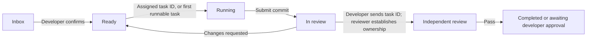

# MileStack user guide

[English](user-guide.md) | [简体中文](user-guide.zh-CN.md) | [Back to README](../README.en.md)

This guide covers installing MileStack, connecting it to a coding client, and using it in an existing project. For source builds and contribution workflows, see the [development guide](development.md).

## Requirements

- Node.js 22 or newer
- Git when an agent submits a fixed commit for review
- A supported MCP client if you want coding agents to read and update MileStack directly

## Install MileStack

### Global installation

This is the recommended option for most users:

```bash
npm install -g milestack
milestack --help
```

Persistent MCP configuration points to the `milestack` command, so the command must remain available on `PATH` whenever the coding client starts.

### Project-pinned installation

Use a development dependency when a repository needs to pin a specific MileStack version:

```bash
cd /absolute/path/to/project
npm install --save-dev milestack
./node_modules/.bin/milestack init --client codex --project "$PWD"
```

Run `init` through the project binary. Do not use `npx milestack` or `npm exec milestack` for persistent setup: those runners may expose a temporary command that stops working after their cache is cleared.

## Initialize a project

```bash
cd /absolute/path/to/project
milestack init --project "$PWD"
```

Initialization is safe to repeat. It:

- creates or migrates `.milestack/milestack.db`;
- adds `.milestack/` to `.gitignore` without replacing existing content;
- generates `.milestack/agent-instructions.md`;
- prints generic MCP configuration guidance;
- leaves the root `AGENTS.md` and global client configuration untouched.

Add the following line to the project's version-controlled root `AGENTS.md`:

```md
Before working on tasks, read and follow `.milestack/agent-instructions.md`; if it is missing, call the MileStack MCP tool get_agent_instructions.
```

The generated file is local and not in Git, so it is missing in a worktree or checkout where `milestack init` has not run. The read-only MCP tool `get_agent_instructions` returns the same full instructions for the running MileStack version, so any agent with a working MileStack MCP connection can still load them. A root `AGENTS.md` that only has the older line (`Before working on tasks, read and follow .milestack/agent-instructions.md`) is still recognized as referencing the file; add the fallback clause when you want agents to know about the tool.

MileStack deliberately does not create or edit the root `AGENTS.md`: project-level agent instructions require developer review.

Every developer should run `milestack init` in each checkout. The `.milestack/` directory is local and intentionally ignored by Git.

## Connect a coding client

For clients that support project-level MCP configuration, pass one or more explicit `--client` values:

```bash
milestack init \
  --client claude \
  --client cursor \
  --client grok \
  --client codex \
  --client opencode \
  --project "$PWD"
```

| Client | Project configuration | Notes |
| --- | --- | --- |
| Claude | `.mcp.json` | Claude asks for approval before using project MCP configuration. |
| Cursor | `.cursor/mcp.json` | Bound to the absolute path of the current checkout. |
| Grok | `.grok/config.toml` | Bound to the absolute path of the current checkout. |
| Codex | `.codex/config.toml` | The repository must be trusted before project configuration takes effect. |
| OpenCode | `opencode.json` | Uses the official top-level `mcp.milestack` shape. |
| AGY | Manual user-level registration | Uses dynamic project discovery instead of a fixed project path. |

`init` only adds a missing MileStack entry. It preserves unrelated settings and an existing different `milestack` entry. It never changes global configuration under `~/.claude.json`, `~/.cursor`, `~/.grok`, `~/.codex`, `~/.config/opencode`, or `~/.gemini`.

After creating or changing client configuration, restart that coding client.

### AGY (Gemini CLI)

AGY currently uses user-level MCP configuration. A fixed `--project` path would make every AGY workspace point to the same project, so MileStack uses fail-closed dynamic discovery instead:

```bash
agy mcp add milestack -- milestack mcp --discover
agy mcp list
```

Start AGY from an initialized project, then verify the binding:

```bash
milestack status --discover
```

Discovery accepts only workspace roots that resolve to one initialized MileStack project. It exits with an error rather than selecting an arbitrary project when roots are missing, unsafe, or ambiguous.

To replace a legacy fixed-project registration:

```bash
agy mcp remove milestack
agy mcp add milestack -- milestack mcp --discover
```

## Open the project dashboard

```bash
milestack serve --project "$PWD"
```

Open [http://127.0.0.1:7331](http://127.0.0.1:7331). The dashboard shows:

- work currently being executed;
- the ordered ready queue and unfinished dependencies;
- blocked tasks and the action needed to unblock them;
- implementations waiting for review;
- inbox work that still needs developer triage;
- recently completed tasks.

The server listens on the local loopback interface by default. The default port is 7331. If it is taken, for example because another project's `serve` is already running, `serve` tries 7332, 7333, and so on up to 7350, uses the first free port, and prints a line naming the occupied ports and the port it switched to. Open the address printed in the terminal rather than assuming 7331. If this project's own `serve` is already running, the command prints its address (`http://127.0.0.1:<port>`) and exits with status 0 instead of starting a second instance. If every port from 7331 to 7350 is taken, it exits with an error that suggests `--port`.

To pick a port yourself:

```bash
milestack serve --project "$PWD" --port 7332
```

An explicit `--port` is used as given: if that port is taken, `serve` exits with an error and does not try other ports.

## Page comments

MileStack ships a lightweight page-comment bookmark: comment directly on elements in a local development page, then hand the formatted text to a coding agent. Only `localhost` pages are supported for now.

### Install

1. Run `milestack serve --project "$PWD"` and open the WebUI address printed in the terminal.
2. Click the “页面评论” (Page comments) entry in the header, then drag the “页面评论” button from the dialog to your browser's bookmarks bar. If the bookmarks bar is hidden, press ⌘+Shift+B (Windows/Linux: Ctrl+Shift+B) to show it.
3. If dragging does not work, click “复制控制台片段” (Copy console snippet) and paste it into the target page's DevTools Console.

The bookmark and snippet contain only a small loader. They load `/page-comments.js` from a running MileStack service, trying the service address that generated the bookmark first and then ports 7331–7350. They do not embed the comment script and do not call the MileStack API. When no MileStack service is running, the page shows “未找到运行中的 MileStack 服务，请先运行 milestack serve” (No running MileStack service found; run milestack serve first).

### Use

1. Open the localhost development page you want to comment on and click the “页面评论” bookmark. The comment toolbar appears at the bottom right.
2. Click an element and write a comment; a numbered marker appears on the element. Switch to “已暂停” (paused) when you need to expand a menu, open a dialog, or change routes normally.
3. Click a number to edit or delete a comment. The toolbar provides the list, copy all, clear, and exit. Clicking a comment for the current page in the list scrolls to its element and opens it for editing. Clicking the bookmark again hides or shows the toolbar.
4. After a hot update, markers are re-located using the element's clues. When the original element cannot be found, a dashed “原元素已变化” (element changed) marker stays at the original position; you can edit, delete, or reassign the comment to a new element. After a full page reload, click the bookmark again to restore comments.
5. Click “复制全部” (Copy all), or click “复制” (Copy) on a comment in the list to copy only that comment, and paste the text to your coding agent.

The agent first organizes the comments: it locates the code for each item, merges comments about the same place, separates requirements that involve data or APIs, and asks the developer about decisions with recommendations. Only after the developer confirms does it create tasks or change code.

Only `localhost` pages are supported for now. Pages served over public HTTPS or with a strict CSP are not guaranteed to work.

## Core concepts

### What MileStack records

- **The database is the source of truth.** Tasks, current progress, next steps, blockers, and completion live in the MileStack database instead of scattered `TODO.md`, `PLAN.md`, or handoff files.
- **Projects come first, not agents.** An agent is a participant in one task run. MileStack keeps no stable agent identity, capability profile, or performance statistics; an optional actor label is only shown in the dashboard.
- **Semantic progress, not raw activity.** Agents record milestones, the current step, the next step, and blockers. MileStack does not record commands, tool calls, file edits, or reasoning.
- **Current state and history are separate.** Each task keeps one authoritative current snapshot for quick reading, plus an immutable event history for audit and handoff.
- **Local-first.** All data stays in the project's `.milestack/` directory. No account, cloud service, or remote database is involved.

### Task states

| State | Meaning |
| --- | --- |
| `inbox` | Recorded but not yet confirmed by the developer; not part of the execution queue. |
| `ready` | Confirmed and queued. It becomes runnable once all dependencies are completed. |
| `running` | Claimed by one agent run and in progress. |
| `in_review` | A fixed commit has been submitted and is waiting for review, developer approval, or the local integration check. |
| `completed` | The risk-specific acceptance requirements and the local integration requirement are both satisfied. |

Only a developer moves work from `inbox` to `ready`. When an agent cannot continue, it records the blocker, the required action, and a handoff note on the running task with `update_task`, then stops; the task stays `running` and keeps its ownership. After the blocker is resolved, the same run can continue, or a developer can release the task from the dashboard, which returns it to `ready` for another agent. See [Task and review lifecycle](#task-and-review-lifecycle) for the review path.

### Execution ownership

- `start_task` claims a task atomically. When several agents try to claim the same task, exactly one succeeds.
- A claim is rejected while the task's risk is unconfirmed or any dependency is incomplete. Agents cannot confirm or lower a task's risk.
- A successful claim returns a `runId`. Progress updates and submission must carry it, so a late update from an earlier run cannot change the task.
- Releasing or submitting a task invalidates its `runId`. Rework after a changes-requested review or a reopen requires a new `start_task`.
- Review uses its own `reviewRunId` from `start_review`. Each new submission opens a new review round, and conclusions from earlier rounds no longer decide the task.

### What MileStack does not do

- Track Git diffs, shell commands, file changes, token usage, or model cost.
- Plan, prioritize, split, or schedule work automatically, or start agents on its own.
- Manage agent identities, permissions, or performance profiles.
- Provide cloud accounts, team permissions, remote sync, or a multi-project workspace.
- Import existing task documents automatically.

## Day-to-day workflow

### Developer responsibilities

1. Work through the requirements and solution with a strong reasoning model, confirming the objective, boundaries, and important constraints.
2. Review the inbox tasks created by the AI from that discussion and check that nothing was omitted or expanded without agreement.
3. Choose task risk, verify dependencies, and order the ready queue.
4. Send a task ID or brief when you want a specific task implemented; otherwise the agent selects the first runnable task in queue order.
5. After submission, send the same task ID to an independent review agent; the reviewer does not select a review task itself.
6. Review blockers and actions that require human input; approve medium- and high-risk work after an independent review passes.
7. Edit, reopen, or return work when the task definition or submitted result needs correction.

### Coding-agent responsibilities

1. After the requirements and solution are agreed, turn the discussion into concrete, verifiable MileStack inbox tasks without inventing unconfirmed scope. Before creating a task, confirm you can state the observable outcome, explicit exclusions, and verification. If anything is unclear, ask a small batch of targeted questions with recommended defaults, and record unanswered points as labeled assumptions in the task.
2. As an implementation agent, load a developer-provided task ID directly. If no task ID is provided, query project status, select the first task in `next` with `runnable = true`, then call `start_task` to establish execution ownership.
3. Record meaningful milestones, the current step, the next step, or a blocker—rather than every command and file edit.
4. When independent follow-up work is discovered during implementation or review, propose it with a title and a one-sentence reason in the handoff or summary and in the final reply instead of creating it; create the task only after the developer confirms it.
5. Verify all task acceptance criteria and the scope required by the root `AGENTS.md`, then submit a fixed 40-character Git commit and leave a clear completion summary.
6. As a review agent, first receive a task ID from the developer, then call `start_review` to establish review ownership; do not select a pending review yourself. Confirm `phase=review` with `get_task`, review the exact submitted commit, independently reproduce the key verification for each acceptance criterion and the project's task-branch scope instead of trusting the submitter's recorded evidence, check the diff against the task boundary and the root `AGENTS.md`, close every finding from a previous changes-requested round (without treating the incremental diff as a substitute for verifying every criterion and task-branch scope), and conclude with one review decision tool.

The ready queue expresses developer preference. Dependencies determine whether a ready task is runnable. If several tasks are runnable, they may be worked on in parallel only when each writing agent has an isolated branch and worktree.

A task returned by a changes-requested review moves back to the top of the ready queue. It shows a `退回 第 N 轮` badge with the latest review summary or finding count, and the queue header shows a clickable `N 个待返工` count that scrolls to the first returned task.

## Task and review lifecycle



An implementation agent prioritizes a developer-provided task. If no task ID is provided, it selects the first runnable task in queue order. Review work is still assigned by sending the task ID to an independent review agent. `start_task` and `start_review` establish concurrency-safe, short-lived credentials. Submitting invalidates the execution credential. Returning work for changes invalidates the old execution and review credentials, so rework must establish new execution ownership before a new review round.

The MCP server instructions and the `start_review` tool description carry the review entry flow and review dimensions, so an agent connected only through MCP can review without reading `.milestack/agent-instructions.md`. A reviewer must independently reproduce key verification rather than trusting the submitter's recorded criteria results, inspect the diff for work outside the task boundary, and check the result against the root `AGENTS.md`. Finding severity supports triage; it does not permit a pass while a submitted criterion is not met or unverifiable, or a previous finding remains not fixed or partially fixed.

Task creation, submission, independent review, and re-review all respect any tiered verification strategy defined in the repository root `AGENTS.md`. When a project schedules repository-wide full regression at the target-branch merge stage instead of on every task branch, ordinary single-task acceptance criteria should not include generic merge-stage full-suite tests (include full regression only when the task itself directly affects global behavior and requires early regression). On the task branch, implementation and independent review verify all task acceptance criteria and the project's defined change-related scope—without rerunning the full regression suite on every task branch unless the task explicitly requires it—while the reviewer still independently reproduces key task-branch verification rather than accepting the submitter's recorded results.

| Risk | After an independent AI review passes |
| --- | --- |
| Low | The review records automatic acceptance; completion follows only after the local integration requirement is satisfied. |
| Medium | Waits for developer approval, then for the local integration requirement if required. |
| High | Waits for developer approval, then for the local integration requirement if required. |

### Local integration and completion

Every new task defaults to requiring its fixed reviewed commit on the local `main` branch. Before work starts, a developer can choose another local target branch or record that Git integration is not required, with a reason. The review round freezes that choice. After the risk-specific review and approval requirements are met, MileStack checks whether the exact reviewed commit is reachable from the selected local branch. If Git cannot prove that, the approval remains recorded, the task stays visible, and dependents remain blocked. Use **Check and archive** to retry after an authorized local merge or a Git repair. The check is read-only; it does not merge, fetch, or push, and it does not mean the work was published or deployed. A squash or rebase that changes the reviewed commit SHA cannot be proven by this check.

## CLI reference

```text
milestack init [--project <path>] [--client <name>]...
milestack status [--project <path>] [--discover] [--json]
milestack mcp [--project <path>] [--discover]
milestack serve [--project <path>] [--port <port>]
milestack update [--project <path>] [--check]
milestack -v | --version
```

Examples:

```bash
milestack status --project "$PWD"
milestack status --project "$PWD" --json
milestack status --discover
milestack mcp --discover
```

## MCP capabilities

| Area | Tools |
| --- | --- |
| Agent instructions | `get_agent_instructions` |
| Query | `get_project_status`, `list_tasks`, `get_task` |
| Task creation | `create_task`, `create_tasks` |
| Inbox editing | `edit_inbox_task` |
| Execution | `start_task`, `update_task`, `submit_for_review` |
| Review | `start_review`, `approve_review`, `request_changes`, `complete_review`, `check_task_integration` |

Tasks an agent creates after developer confirmation enter the inbox. A developer must confirm their risk and queue position before they become claimable. `edit_inbox_task` requires the latest `updatedAt` from `get_task`, rejects an edit when the task changed since it was read, cannot change risk, and only works on inbox tasks.

`get_task` defaults to the `working` view, which keeps the full task definition and current work context. Pass `view: "full"` to inspect every immutable task event and review record. The HTTP task-detail endpoint used by the Web UI always returns the full timeline.

## Local data and upgrades

Project data is stored in `.milestack/` and must not be committed. SQLite connections use WAL mode, foreign keys, and a busy timeout so the local web server and MCP processes can share the database safely.

Before applying a pending migration to a non-empty database, MileStack creates a backup in `.milestack/backups/`. Do not delete an existing database to upgrade.

### Check the version

```bash
milestack -v
milestack --version
```

Both print one line to standard output: the current version and the realpath of the entry file for this run. The Web UI also displays the version of the running MileStack process.

### Upgrade

`milestack update` upgrades npm global installations, and project-local installations already declared in a project's `package.json` `dependencies` or `devDependencies`, then refreshes the files generated by `init` in initialized projects.

- A project-local upgrade runs the fixed package-manager command only in the project root that declares the dependency; it never installs another global copy.
- Source checkouts and entries linked back to a source checkout with `pnpm link --global` keep the existing rule: run `pnpm build` in that repository. `update` does not treat them as installed packages.
- After a successful install, `update` asks the newly installed version to regenerate the files, then confirms the generated file carries the new version before reporting it refreshed. If that fails, or the new CLI cannot be located, it says the file was not updated and asks you to run `milestack update` once more.
- `--check` only reports the current version, latest version, and generated-file status; it does not install or write files.

`milestack serve` checks the npm registry once at startup. When a newer version is available, it prints one line in the terminal and shows `有新版本 <version>` with the upgrade command beside the running version in the Web UI header. The header only shows the command; it has no install button or endpoint. The check never delays listening, the access URL, or API responses, and it runs only once: a failed, slow, or offline query stays silent and the running process does not recheck later. Upgrade by running the command that was shown, then restart `milestack serve` and MCP clients so they load the new version.

With a global install, `milestack update` run in one project does not touch other projects' generated files. When you restart `milestack serve` in another initialized project, it checks `.milestack/agent-instructions.md` once at startup; if the version in its first-line generation marker is lower than the running version, it rewrites the file with the full current generation and prints one line saying so. The refresh only moves forward: it never writes when the versions are equal, the file is newer, or the running version is `unknown` (running from source). A missing file, or a file whose first line has no generation marker, is not created or overwritten; the terminal prints a line suggesting `milestack update` in that project. If the write fails, `serve` still starts and prints a warning. Only `milestack serve` does this; `milestack mcp`, `status`, `init`, and `update` behave as before, and projects where you do not start `serve` still need `milestack update`.

`update` prints a checklist of steps as it works. In a terminal, the running step shows a spinner and elapsed time that refresh in place; finished steps show their result and duration, and steps not started yet show `○`:

```text
 MileStack update  0.2.2 → 0.2.3

  ✔ Detect install method   npm global install      0.3s
  ✔ Query latest version    0.2.3 available         1.1s
  ⠼ Install milestack@0.2.3                         23s
  ○ Refresh generated files

 ✓ Upgraded to 0.2.3 · restart MCP clients and milestack serve
```

(The tool prints its step labels in Chinese; the lines above are translated.) When a query or install fails, the failed step is marked `✖` with the last 20 lines of the package manager's output and the command to run by hand, and no later step runs. When output is redirected to a file or pipe, it prints plain text lines without animation, cursor control, or colors, and shows each finished step right away. Setting `NO_COLOR` in a terminal only turns the colors off; the in-place spinner stays. Upgrade arrows and the "Upgraded to" summary appear only when an install actually ran.

If you currently have 0.1.0 installed, the first upgrade cannot use `milestack update`. Install 0.2.0 or a later version with the original installation method first:

- global: `npm install -g milestack@latest`;
- project-local: install `milestack@latest` in the project root that declares the dependency. For example, run `npm install --save-dev milestack@latest` in an npm project or `pnpm update milestack --latest` in a pnpm project.

After 0.2.0 or a later version is installed, `milestack update` can handle later upgrades. If you already have 0.2.0 or a later version installed, `milestack update` upgrades to 0.2.5.

Versions 0.2.2 and earlier refresh the generated files with their own old code after installing, so when upgrading from 0.2.2 or earlier, the file still carries the old version after `update` reports success. After that upgrade finishes, run `milestack update` once more in every initialized project.

After upgrading, open a new terminal and restart the MCP client and `milestack serve` so they load the new version. Keep the existing database; no deletion is needed. The program applies forward migrations to non-empty databases and creates a backup before migrating.

## Troubleshooting

### The client cannot find the MileStack tools

- Confirm that `milestack --help` works in a new terminal.
- Inspect the client project file created by `init`.
- Confirm that its `--project` value is the absolute path of the checkout that holds `.milestack/milestack.db`. In a git worktree, that is the main worktree (see below).
- Restart the client after changing MCP configuration.
- For Codex, confirm that the repository is trusted; for Claude, approve the project MCP configuration.

### Using MileStack in a git worktree

`.milestack/`, `.mcp.json`, and the other client files are ignored by Git, so `git worktree add` does not copy them. A linked worktree always uses the MileStack project of the repository's main worktree; it never gets a database of its own. Do not copy `.milestack/milestack.db` into a worktree.

- Run `milestack init --client <name>` inside the worktree. It creates no database. It writes `.milestack/agent-instructions.md` and the selected client configuration in the worktree, with `--project` pointing at the main worktree. If the main worktree has not been initialized yet, the command fails without writing anything; run `init` in the main worktree first.
- Alternatively, start the coding session from the main worktree directory.
- `milestack status --discover` and `milestack mcp --discover` run from a worktree find the main worktree's project, and `--project <worktree path>` resolves to it as well, for `status`, `mcp`, and `serve`. When the main worktree has no MileStack project yet, these commands fail with the path to initialize instead of creating a database in the worktree.

### The wrong project is shown

Project-level clients are bound to the absolute checkout path recorded during `init`. Re-run `init` in the intended checkout and inspect any existing MileStack entry; a different existing entry is preserved instead of overwritten.

For AGY, run `milestack status --discover` from the project directory and make sure the workspace does not span multiple MileStack projects.

### The Web UI still shows an older version

Stop and restart `milestack serve` after upgrading. The running process checks the npm registry once at startup, never rechecks later, and never changes its displayed version automatically.
