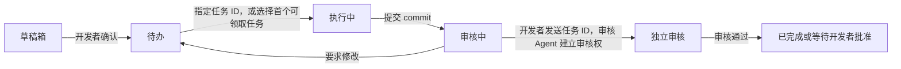

# MileStack 用户指南

[English](user-guide.md) | [简体中文](user-guide.zh-CN.md) | [返回 README](../README.md)

本文介绍如何安装 MileStack、连接编程客户端，并在已有项目中开始使用。如需从源码构建或参与开发，请阅读[开发指南](development.zh-CN.md)。

## 环境要求

- Node.js 22 或更高版本
- Agent 提交固定 commit 进行审核时需要 Git
- 如需让编程 Agent 直接读写 MileStack，需要支持的 MCP 客户端

## 安装 MileStack

### 全局安装

这是大多数用户的推荐方式：

```bash
npm install -g milestack
milestack --help
```

持久 MCP 配置会指向 `milestack` 命令，因此每次启动编程客户端时，该命令都需要位于 `PATH` 中。

### 在项目中锁定版本

如果仓库需要固定 MileStack 版本，可以将其安装为开发依赖：

```bash
cd /项目的绝对路径
npm install --save-dev milestack
./node_modules/.bin/milestack init --client codex --project "$PWD"
```

请通过项目中的二进制运行 `init`。不要使用 `npx milestack` 或 `npm exec milestack` 建立持久配置：这些运行器可能暴露临时命令，缓存被清理后配置就会失效。

## 初始化项目

```bash
cd /项目的绝对路径
milestack init --project "$PWD"
```

初始化可以安全地重复执行。它会：

- 创建或迁移 `.milestack/milestack.db`；
- 在不替换原有内容的前提下，将 `.milestack/` 加入 `.gitignore`；
- 生成 `.milestack/agent-instructions.md`；
- 输出通用 MCP 配置指引；
- 保持根 `AGENTS.md` 和客户端全局配置不变。

请把下面这行加入项目版本控制中的根 `AGENTS.md`：

```md
Before working on tasks, read and follow `.milestack/agent-instructions.md`.
```

MileStack 有意不创建或修改根 `AGENTS.md`，因为项目级 Agent 指令必须由开发者亲自审核。

每位开发者都应在自己的 checkout 中运行一次 `milestack init`。`.milestack/` 是本地目录，并且有意被 Git 忽略。

## 连接编程客户端

对于支持项目级 MCP 配置的客户端，传入一个或多个明确的 `--client`：

```bash
milestack init \
  --client claude \
  --client cursor \
  --client grok \
  --client codex \
  --client opencode \
  --project "$PWD"
```

| 客户端 | 项目配置 | 说明 |
| --- | --- | --- |
| Claude | `.mcp.json` | 使用项目 MCP 配置前，Claude 会要求用户批准。 |
| Cursor | `.cursor/mcp.json` | 绑定当前 checkout 的绝对路径。 |
| Grok | `.grok/config.toml` | 绑定当前 checkout 的绝对路径。 |
| Codex | `.codex/config.toml` | 项目配置只在已信任的仓库中生效。 |
| OpenCode | `opencode.json` | 使用官方顶层 `mcp.milestack` 结构。 |
| AGY | 手动注册到用户级配置 | 使用动态项目发现，而不是固定项目路径。 |

`init` 只添加缺失的 MileStack 条目。它会保留无关设置和已有的不同 `milestack` 条目，也绝不会修改 `~/.claude.json`、`~/.cursor`、`~/.grok`、`~/.codex`、`~/.config/opencode` 或 `~/.gemini` 下的全局配置。

创建或修改客户端配置后，请重启对应的编程客户端。

### AGY（Gemini CLI）

AGY 目前使用用户级 MCP 配置。如果写入固定的 `--project`，所有 AGY 工作区都会指向同一个项目。为避免跨项目误读写，MileStack 改用失败关闭的动态发现：

```bash
agy mcp add milestack -- milestack mcp --discover
agy mcp list
```

从一个已经初始化的项目中启动 AGY，然后验证绑定结果：

```bash
milestack status --discover
```

动态发现只接受能够唯一映射到一个已初始化 MileStack 项目的工作区根。如果根目录缺失、不安全或存在歧义，服务会报错退出，而不会随意选择某个项目。

替换旧的固定项目注册：

```bash
agy mcp remove milestack
agy mcp add milestack -- milestack mcp --discover
```

## 打开项目页面

```bash
milestack serve --project "$PWD"
```

打开 [http://127.0.0.1:7331](http://127.0.0.1:7331)。页面会展示：

- 当前正在执行的工作；
- 按顺序排列的待办及其未完成依赖；
- 被阻塞的任务和解除阻塞所需的行动；
- 等待审核的实现；
- 尚待开发者整理的草稿任务；
- 最近完成的任务。

服务默认只监听本机回环地址。如需使用其他端口：

```bash
milestack serve --project "$PWD" --port 7332
```

## 日常工作流

### 开发者负责什么

1. 与擅长深度推理的模型讨论需求和方案，确认目标、边界和关键约束。
2. 检查 AI 根据讨论结论创建的草稿任务，确认内容没有遗漏或擅自扩展。
3. 选择任务风险等级、核对依赖，并排列待办顺序。
4. 需要指定任务时，将任务 ID 或任务简报发给实施 Agent；未指定时，Agent 会按队列选择第一个可领取任务。
5. 实施提交后，将同一任务 ID 发给独立审核 Agent；审核 Agent 不自行选择待审核任务。
6. 查看阻塞和需要人类处理的行动；在独立审核通过后批准中风险和高风险工作。
7. 当任务定义或提交结果需要调整时，编辑、重新打开或退回任务。

### 编程 Agent 负责什么

1. 需求和方案确认后，将讨论结论整理成目标明确、可验证的 MileStack 草稿任务，不自行增加尚未确认的范围。
2. 作为实施 Agent 时，有任务 ID 就直接读取指定任务；没有任务 ID 就先查询项目状态，选择 `next` 中第一个 `runnable = true` 的任务，再调用 `start_task` 建立本轮执行权。
3. 记录阶段成果、当前步骤、下一步或阻塞，而不是每条命令和每次文件修改。
4. 实施中发现独立的后续工作时，将其创建为新的草稿任务。
5. 提交一个固定的 40 位 Git commit，并留下清楚的完成摘要。
6. 作为审核 Agent 时，必须先收到开发者提供的任务 ID；再调用 `start_review` 建立审核权，不自行选择待审核任务。

待办顺序表达开发者的执行偏好，任务依赖决定一个待办是否真正可执行。如果同时有多个可执行任务，只有在每个写入 Agent 都拥有独立分支和 worktree 时，才适合并行实施。

## 任务与审核生命周期



实施 Agent 优先处理开发者指定的任务；没有任务 ID 时，按队列选择第一个可领取任务。审核任务仍由开发者把任务 ID 发给独立审核 Agent。`start_task` 与 `start_review` 会建立并发安全的短期凭证。提交审核后，执行凭证会失效；退回修改会使旧的执行与审核凭证一同失效，因此返工需要重新建立执行权，并作为新一轮审核提交。

| 风险 | 独立 AI 审核通过后 |
| --- | --- |
| 低风险 | 审核记录自动验收；本地集成要求满足后才完成。 |
| 中风险 | 等待开发者批准；批准后还需满足本地集成要求。 |
| 高风险 | 等待开发者批准；批准后还需满足本地集成要求。 |

### 本地集成与任务完成

每个新任务默认要求固定审核提交进入本地 `main`。任务开始前，开发者可以指定其他本地目标分支，或填写原因明确记录无需 Git 集成。该选择会冻结在本轮审核记录中。风险对应的审核和批准要求满足后，MileStack 检查固定审核提交是否可从选定的本地分支到达。Git 无法证明时，已记录的批准仍保留，任务继续显示，下游任务仍等待依赖完成。获授权在本地合并或修复 Git 后，可点击“检查并归档”重试。检查只读，不执行合并、fetch 或 push，也不表示已发布或部署。若 squash/rebase 改变了审核提交 SHA，该检查无法证明提交已集成。详情见[任务集成交付与归档检查方案](./task-integration-and-archival.md)。

## CLI 命令

```text
milestack init [--project <path>] [--client <name>]...
milestack status [--project <path>] [--discover] [--json]
milestack mcp [--project <path>] [--discover]
milestack serve [--project <path>] [--port <port>]
milestack update [--project <path>] [--check]
milestack -v | --version
```

示例：

```bash
milestack status --project "$PWD"
milestack status --project "$PWD" --json
milestack status --discover
milestack mcp --discover
```

## MCP 能力

| 类别 | 工具 |
| --- | --- |
| 查询 | `get_project_status`、`list_tasks`、`get_task` |
| 创建任务 | `create_task`、`create_tasks` |
| 执行 | `start_task`、`update_task`、`submit_for_review` |
| 审核 | `start_review`、`approve_review`、`request_changes`、`complete_review`、`check_task_integration` |

Agent 创建的任务会进入草稿箱。开发者确认风险和队列位置后，任务才可以被领取。

`get_task` 默认返回 `working` 视图，完整保留任务定义并提供当前工作上下文。传入 `view: "full"` 可查看全部不可变任务事件和审核记录。WebUI 使用的 HTTP 任务详情接口始终返回完整时间线。

## 本地数据与升级

项目数据保存在 `.milestack/` 中，不应提交到 Git。SQLite 连接启用 WAL 模式、外键约束和 busy timeout，使本地 Web 服务和 MCP 进程能够安全共享数据库。

对非空数据库应用待执行迁移前，MileStack 会在 `.milestack/backups/` 中创建备份。升级时不要删除已有数据库。

### 查看版本

```bash
milestack -v
milestack --version
```

两者都会向标准输出打印一行：当前版本号和本次运行入口文件的 realpath。Web UI 也显示当前运行中的 MileStack 进程版本。

### 升级

`milestack update` 会升级 npm 全局安装，以及已经写入某个项目 `package.json` 的 `dependencies` 或 `devDependencies` 的项目内安装，然后刷新已初始化项目中由 `init` 生成的文件。

- 项目内升级只在该依赖声明所在的项目根目录执行固定的包管理器命令，不会另外安装一份全局命令。
- 从源码目录运行，以及通过 `pnpm link --global` 链回源码仓库的入口，仍按现有规则在该仓库内执行 `pnpm build`，`update` 不会把它们当成已安装的包去升级。
- `--check` 只报告当前版本、最新版本和生成文件状态，不安装、不写文件。

如果你现在安装的是 0.1.0，第一次升级还不能使用 `milestack update`，请先用原来的安装方式装到 0.2.0 或更高版本：

- 全局安装：`npm install -g milestack@latest`；
- 项目内安装：在声明了该依赖的项目根目录安装 `milestack@latest`，例如 npm 项目执行 `npm install --save-dev milestack@latest`，pnpm 项目执行 `pnpm update milestack --latest`。

装上 0.2.0 或更高版本之后，才可以使用 `milestack update` 继续升级。已经安装 0.2.0 的用户可以直接用 `milestack update` 升级到 0.2.1。

升级后请新开一个终端，并重启 MCP 客户端和 `milestack serve`，确保它们加载新版本。已有数据库会保留，不需要删除；程序会对非空数据库执行前向迁移，并在迁移前创建备份。

## 常见问题

### 客户端找不到 MileStack 工具

- 在新终端中确认 `milestack --help` 可以运行。
- 检查 `init` 创建的客户端项目文件。
- 确认其中 `--project` 的值是当前 checkout 的绝对路径。
- 修改 MCP 配置后重启客户端。
- 使用 Codex 时确认仓库已受信任；使用 Claude 时批准项目 MCP 配置。

### 页面或 Agent 显示了错误的项目

项目级客户端会绑定 `init` 时记录的 checkout 绝对路径。请在目标 checkout 中重新运行 `init`，并检查是否已经存在不同的 MileStack 条目；`init` 会保留已有的不同条目，而不是覆盖它。

使用 AGY 时，请从项目目录运行 `milestack status --discover`，并确认工作区没有同时跨越多个 MileStack 项目。

### Web UI 仍然显示旧版本

升级后停止并重新启动 `milestack serve`。运行中的进程不会访问 npm Registry，也不会自动改变显示的版本。
